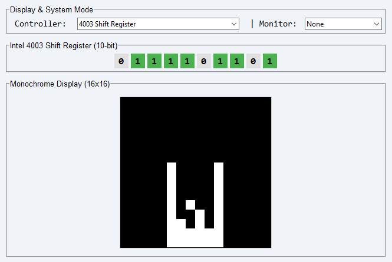
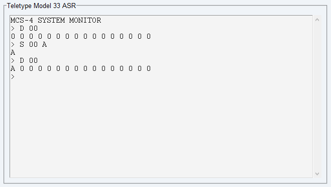

<h1 align="center">Intel 4004 CPU Emulator</h1>

## Introduction

The [Intel 4004](https://en.wikipedia.org/wiki/Intel_4004) Emulator is an accurate and fast software implementation of the first commercially available microprocessor, released by Intel in 1971. The project reproduces all 46 CPU instructions, including two-byte commands, page-based addressing, the three-level circular stack, and the Harvard architecture with separate program and data memory spaces.

The emulator is written entirely using the [Python](https://en.wikipedia.org/wiki/Python_(programming_language)) standard library: `re`, `os`, `glob`, `time`, `tkinter`, `tkinter.ttk`, `tkinter.scrolledtext`, `tkinter.messagebox`, and `tkinter.filedialog`. This is a deliberate choice in favor of maximum portability and simplicity: no third-party packages or complex dependencies are required. All you need is a Python interpreter and its standard library.

Beyond accurate CPU emulation, the project provides a complete environment for learning, developing, and testing programs. It includes a built-in [assembler](https://en.wikipedia.org/wiki/Assembly_language) with support for both historical and modern syntax, a [linker](https://en.wikipedia.org/wiki/Linker_(computing)) for modular assembly, a [BASIC](https://en.wikipedia.org/wiki/Tiny_BASIC) compiler as a teaching language for first steps, and a set of virtual peripherals — teletype, disk drive, video chips, and UART. Together, these turn the emulator into an educational workbench where you can write code, watch registers change, debug programs, and experiment with the constraints of 4-bit architecture without risking real hardware.

The goal of the project is not merely to preserve historical heritage, but to make it tangible and understandable. The emulator strives to be well-structured, easy to study, and solid enough to withstand the test of time.

## Accuracy and Testing

The emulator reproduces Intel 4004 behavior at the instruction level. To ensure functional accuracy and verify that all 46 instructions operate exactly as documented in Intel's 1971 manuals, I have included a comprehensive suite of assembly tests.

These tests validate CPU flags, arithmetic edge cases, stack behavior, and peripheral I/O. Below are the core validation tests included in the `tests/` directory.

### Arithmetic & Flags

		
Results

		<table>
				<tr>
						<td align="center" valign="top">
								<a href="src/tests/asm/cpu_core/01_add_carry.asm">
										<b>add_carry.asm</b>
								</a>
						</td>
				</tr>
				<tr>
						<td align="center" valign="top">
								
						</td>
				</tr>
				<tr>
						<td align="center" valign="top">
								<a href="src/tests/asm/cpu_core/02_sub_borrow.asm">
										<b>sub_borrow.asm</b>
								</a>
						</td>
				</tr>
				<tr>
						<td align="center" valign="top">
								
						</td>
				</tr>
				<tr>
						<td align="center" valign="top">
								<a href="src/tests/asm/cpu_core/05_daa_bcd.asm">
										<b>daa_bcd.asm</b>
								</a>
						</td>
				</tr>
				<tr>
						<td align="center" valign="top">
								
						</td>
				</tr>
		</table>

### Control Flow & Architecture

		
Results

		<table>
				<tr>
						<td align="center" valign="top">
								<a href="src/tests/asm/cpu_core/03_jcn_conditions.asm">
										<b>jcn_conditions.asm</b>
								</a>
						</td>
				</tr>
				<tr>
						<td align="center" valign="top">
								
						</td>
				</tr>
				<tr>
						<td align="center" valign="top">
								<a href="src/tests/asm/cpu_core/04_isz_skip.asm">
										<b>isz_skip.asm</b>
								</a>
						</td>
				</tr>
				<tr>
						<td align="center" valign="top">
								
						</td>
				</tr>
				<tr>
						<td align="center" valign="top">
								<a href="src/tests/asm/cpu_core/06_jms_bbl_stack.asm">
										<b>jms_bbl_stack.asm</b>
								</a>
						</td>
				</tr>
				<tr>
						<td align="center" valign="top">
								
						</td>
				</tr>
				<tr>
						<td align="center" valign="top">
								<a href="src/tests/asm/cpu_core/07_fim_jin_indirect.asm">
										<b>fim_jin_indirect.asm</b>
								</a>
						</td>
				</tr>
				<tr>
						<td align="center" valign="top">
								
						</td>
				</tr>
		</table>

### Memory & Peripherals

		
Results

		<table>
				<tr>
						<td align="center" valign="top">
								<a href="src/tests/asm/cpu_core/08_fibonacci_tty.asm">
										<b>fibonacci_tty.asm</b>
								</a>
						</td>
				</tr>
				<tr>
						<td align="center" valign="top">
								
						</td>
				</tr>
				<tr>
						<td align="center" valign="top">
								<a href="src/tests/asm/io_ports/wrm_wmp_io.asm">
										<b>wrm_wmp_io.asm</b>
								</a>
						</td>
				</tr>
				<tr>
						<td align="center" valign="top">
								
						</td>
				</tr>
		</table>

## Case Study: "[Tetris](https://en.wikipedia.org/wiki/Tetris)" on a 4-bit CPU

Writing a game for the Intel 4004 is an exercise in extreme constraints. With no framebuffer, only 4-bit registers, and a strict 3-level hardware stack, the classic "Tetris" mechanics had to be heavily adapted.

Below is a working prototype written in 4004 assembly (`tetris.asm`), which perfectly demonstrates both the genius and the brutal limitations of 1970s hardware.

	
	 
	<em>A 6x9 pixel playfield rendered directly to the 4003 shift register.</em>

### How it works (The Genius Part)

*   **No VRAM, direct pixel access:** The game has no video memory. It draws the walls, the floor, and the falling block by directly manipulating the [4003 shift register](https://insanity4004.blogspot.com/2020/05/the-i4003-shift-register.html) via ports 0 (X), 1 (Y), and 2 (Pixel on/off).

*   **The "Illusion" of a Well:** Because the 4004 lacks sufficient RAM for a 2D array, the game can only remember the coordinates of the *single most recently landed block* (stored in registers `R12` and `R13`). If you drop a second block, the coordinates of the first are overwritten. It plays more like "dodge the obstacle" than a full Tetris tower.

*   **Register Mastery:** I brilliantly uses `R0`/`R1` for the active block, `R6`/`R7` as working coordinates for the drawing subroutines, and `R2`/`R3` for temporary math—all without clashing.

### The Critical Flaw (The Bug)

If you play the prototype and press 'Left' or 'Right' while the block is falling, **the game will crash or jump to a random address.** 

This is not an emulator bug. This is a **real, historical hardware limitation** caused by the 3-level circular stack.

When you press a movement key, the code makes the following nested subroutine calls (`JMS`):

1. `FALL_LOOP` calls `CHECK_INPUT` (Stack Level 1)
2. `CHECK_INPUT` calls `MOVE_LEFT` (Stack Level 2)
3. `MOVE_LEFT` calls `CLEAR_BLOCK` (Stack Level 3)
4. `CLEAR_BLOCK` calls `CLEAR_PIXEL` (**Stack Level 4 — OVERFLOW!**)

Because the 4004 hardware stack only holds three 12-bit return addresses, the 4th call overwrites the address of the 1st. When the emulator tries to execute `BBL` (Return), it jumps back to an entirely wrong place in memory.

*(Note: I do not patch this behavior in the emulator. It strictly reproduces the hardware stack, allowing you to experience the exact same architectural headaches engineers faced in 1971).*

### Why include a "broken" game?

This prototype is a beautiful educational artifact. It shows that on the Intel 4004, **architectural constraints (limited RAM, no multiplication, 3-level stack) dictate game design.** The code is a testament to the programmer's skill in pushing a 4-bit CPU to its absolute limits.

## Ecosystem: The Built-in System Monitor

To demonstrate the emulator's capabilities beyond simple tests, I have included a complete, interactive **System Monitor** (a mini-OS). It is written entirely in Intel 4004 assembly and runs inside the emulator, providing a command-line interface for memory inspection, editing, and disk operations.

  
   
  <em>The System Monitor running in the virtual Teletype, ready to accept commands (D, S, X, G, R, W).</em>

### Engineering Highlights

The monitor is split into several logical modules (`monitor.asm`, `console_io.asm`, `memory_cmd.asm`, `disk_cmd.asm`, `system_cmd.asm`), showcasing how to write structured, maintainable code under extreme memory constraints.

*   **Smart Command Dispatching:** Instead of wasting precious ROM cycles comparing the input character against every single command, the monitor uses a brilliant cascade check based on the ASCII high nibble. It first checks if the command belongs to the `D`/`G` group (high nibble `4`) or the `S`/`X`/`R`/`W` group (high nibble `5`), and only then checks the low nibble.

*   **Hex Conversion on the Fly:** The 4004 has no native string manipulation. The `MON_PUT_HEX_NIB` routine converts 4-bit numbers into ASCII characters (`0`-`9`, `A`-`F`) using clever manipulation of the Carry flag.

*   **Modernized Data Storage:** While the original Intel MCS-4 monitor used paper tape for loading programs, my adaptation replaces it with full **Shugart SA 800-1 floppy disk** support. The `R` (Read) and `W` (Write) commands handle complex disk positioning (`HOME`), sector selection, and 128-byte data transfers.

*   **Indirect Jumps:** The `G` (Go) command, which transfers control to a user program, demonstrates the classic 4004 way of indirect jumping: it parses the address into `R0:R1` (Pair `P0`) and executes `JIN P0`.

This monitor proves that despite having only 4-bit registers and a 3-level stack, the 4004 can run a robust command-line environment.

## Documentation

The project comes with comprehensive documentation. Whether you are just starting out or want to understand the emulator's internals, the following guides will help you:

* **[Introduction and Overview](./docs/guides/01-introduction-and-overview.md)**

* **[User Guide](./docs/guides/02-user-guide.md)**

* **[Assembly Programming Guide](./docs/guides/03-assembly-programming-guide.md)**

* **[BASIC Programming Guide](./docs/guides/04-basic-programming-guide.md)**

* **[Toolchain Reference](./docs/guides/05-toolchain-reference.md)**

* **[Architecture and Emulation Reference](./docs/guides/06-architecture-and-emulation-reference.md)**

* **[Peripherals and I/O Reference](./docs/guides/07-peripherals-and-io-reference.md)**

* **[System Monitor and Disk Operations](./docs/guides/08-system-monitor-and-disk-operations.md)**

## Installation

	Work In Progress
	
## References

### 🧭 1. Inspiration & Starting Point

* **[markablov/i40xx — JavaScript Intel 4004/4040 Emulator](https://github.com/markablov/i40xx)**: The architectural reference and primary source of inspiration for the Python port.

### 📚 2. Documentation & MCS-4 Specifications

* **[MCS-4 Users Manual (Feb 1973)](./docs/MCS-4-Users-Manual-(Feb-1973).pdf)**: Full text of the official user manual.

* **[MCS-4 Data Sheet (Nov 1971)](./docs/MCS-4-Data-Sheet-(Nov-1971).pdf)**: Brief specification of electrical parameters and pin assignments.

### 🔌 3. Peripherals (4003, TIA, Teletype, UART, Disk Drive)

* **Intel 4003 Shift Register**

	* **[Insanity 4004 — The i4003 Shift Register](https://insanity4004.blogspot.com/2020/05/the-i4003-shift-register.html)**: Analysis of 4003 emulation, including timing and clocking considerations.

* **Atari TIA (Television Interface Adaptor)**

	* **[Atari 2600 TIA Hardware Notes (Andrew Towers)](./docs/Atari-2600-TIA-Hardware-Notes-(Andrew-Towers).pdf)**: The definitive document on TIA timings and registers.

* **Teletype Model 33 ASR**

	* **[Teletype Model 33 (Wikipedia)](https://en.wikipedia.org/wiki/Teletype_Model_33)**: General history, variants (ASR, KSR, RO), and overview of the device.

	* **[Using the ASR 33 Teletype](./docs/Using-the-ASR-33-Teletype.pdf)**: A practical guide to using the ASR-33 terminal.

* **UART AY-5-1013**

	* **[AY-5-1013 Datasheet](./docs/AY-5-1013.pdf)**: Specification: 5–8 data bits, 1–2 stop bits, up to 40 kbps.

* **Shugart SA 800 / IBM 3740**

	* **[Shugart SA800-801 OEM Manual](./docs/Shugart-SA800-801-OEM-Manual.pdf)**: Original OEM manual with complete specifications, electrical interface, and descriptions of read/write operations.

	* **[IBM 3740 Data Entry System Reference Manual (GA21-9151-0)](./docs/IBM-3740-Data-Entry-System-Reference-Manual-(GA21-9151-0).pdf)**: The original IBM documentation defining the physical and logical layout of the 8-inch diskette format (77 tracks, 26 sectors per track, 128 bytes per sector).

### 🧮 4. Tiny BASIC

* **[pvmm/tinybasic — Palo Alto Tiny BASIC v3](https://github.com/pvmm/tinybasic)**: Source code of Palo Alto Tiny BASIC v3 by Li-Chen Wang (8080/Z-80, ~2K memory).

* **[Palo Alto Tiny BASIC Version 3 Li-Chen Wang 1977](https://archive.org/details/Palo_Alto_Tiny_BASIC_Version_3_Li-Chen_Wang_1977)**: Original publication and source code.

### ⚙️ 5. Assembler

* **[Intel 4004 assembler documentation](https://davkhun.github.io/i4004/docs.html)**: Implementation features and instruction set reference (register pairs, RAM banking, and usage examples).

* **[i40xx-asm (npm)](https://npm.io/package/i40xx-asm)**: Assembler for 4004/4040, with examples of `#` comments and `:` labels.

### 🖥️ 6. MCS-4 System Monitor

* **[Retrotechnology — Intel MCS 4/40 ROM Monitor MON4](https://www.retrotechnology.com/restore/intel440_roms.html)**: Dumps, disassembly, and listing of MON4 V2.1.

## License

Copyright © 2026 Yuriy Konyshev

i4004-py is [free software](https://www.gnu.org/philosophy/free-sw.en.html): you can redistribute it and/or modify it under the terms of the [GNU General Public License](https://www.gnu.org/licenses/gpl-3.0.en.html) as published by the [Free Software Foundation](https://www.fsf.org/), either version 3 of the License, or (at your option) any later version.

**i4004-py is distributed in the hope that it will be useful, but WITHOUT ANY WARRANTY; without even the implied warranty of MERCHANTABILITY or FITNESS FOR A PARTICULAR PURPOSE.** See the GNU General Public License for more details.

You should have received a [copy](./LICENSE) of the GNU General Public License along with i4004-py. If not, see [https://www.gnu.org/licenses/](https://www.gnu.org/licenses/licenses.en.html).
